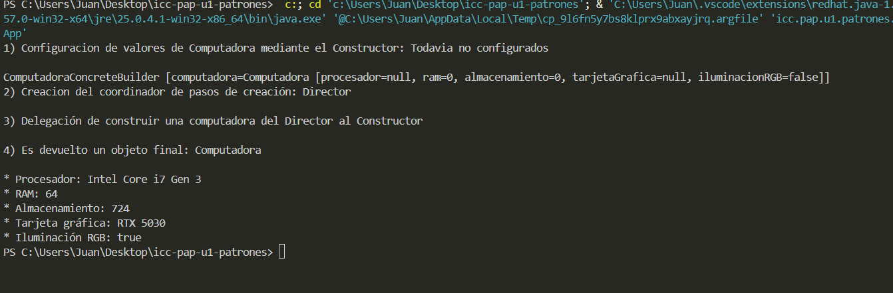

## Ingeniería en Ciencias de la Computación
### Programación Aplicada
### Patrones de Diseño Creacionales
#### José Andrés Astudillo Pacheco

## Builder
Se trata de un patrón creacional el cual permite separar responsabilidades en la creación de un objeto, esto implica
no tener que usar una sobrecarga excesiva de constructores para distintas combinaciones de parámetros que a largo plazo
puede volverse insostenible y muy dependiente del tipo de dato que se haya escrito para evitar escribir un dato incorrecto.
Permite justamente crear varios objetos a través de un solo proceso, junto con entidades que tienen distintas responsabilidades:
* **Producto**: Se trata del modelo o el objeto final que se requiere crear
* **Builder**: Puede ser una interfaz o clase abstracta, lo importante es que define los pasos a realizar
* **ConcreteBuilder**: Define como se realizarán los pasos del Builder, el proceso para ello.
* **Director**: Organiza los pasos del Builder según un orden

Estas entidades son equivalentes en el ejemplo:
* `Computadora`: El objeto que se está construyendo
* `ComputadoraBuilder`: La interfaz que declara pasos de construcción de `Computadora`
* `ComputadoraConcreteBuilder`: Implementa los pasos de `ComputadoraBuilder`
* `ComputadoraDirector` Ordena los pasos de ejecución de la construcción de `ComputadoraBuilder`
* `BuilderDemo` Ejecuta el ejemplo y muestra su resultado

## Explicación del patrón Builder

Primero se comienza con las clases anteriormente presentadas, declarando primeramente el contrato de la interfaz (los métodos a implementar) en `ComputadoraBuilter`ya que esta clase tiene la responsabilidad natural de una interfaz. Posteriormente el `ComputadoraConcreteBuilder` implementa dicha interfaz mediante los setters de la clase `Computadora` para que, al asignar valores a los atributos mediante setters de otra clase, estos puedan modificarse en el objeto final.

Lo importante es que el patrón Builder utiliza los setters para construir el objeto sin impedir que el objeto sea posteriomente modificado. 

Al final de la clase `ComputadoraConcreteBuilder` se realiza un método que retorna un objeto `Computadora` con los valores configurados y `ComputadoraDirector` coordina el orden en que los métodos de construcción de cada atributo(ej. construirProcesador()) van a ejecutarse una vez creado el objeto `ComputadoraConcreteBuilder` en el `BuilderDemo` como una clase de pruebas y demostración

Finalmente se crea una instancia de ConcreteBuilder y Director, para que este último dirija la 
operación de ejecutar el builder, el cual es de clase `ComputadoraBuilder` para reducir acoplamiento o
evitar que el Director quede atado a la clase ConceteBuilder. Obteniéndose un objeto creado por responsabilidades.

